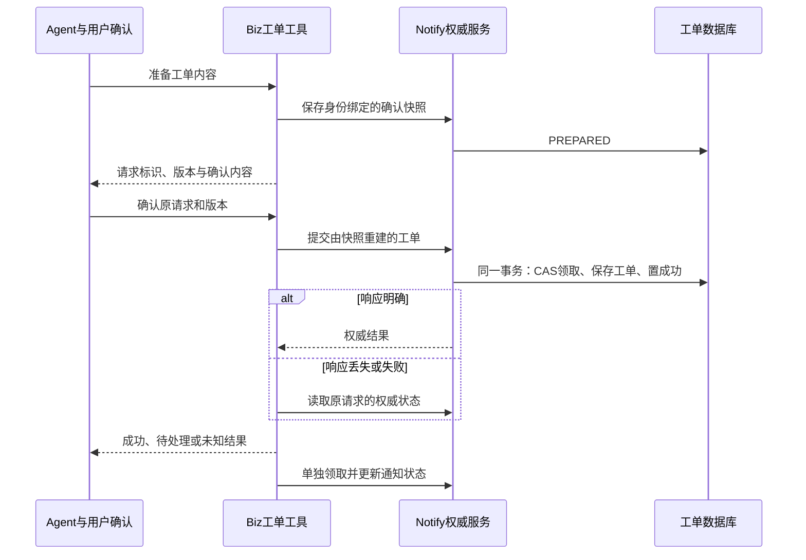

# AI 应用项目：源码实现与项目经历详解

整理日期：2026 年 11 月 16 日。

本文件用于把项目交给其他 AI 或简历编辑者继续加工，阅读者无需原聊天也能理解业务场景、系统结构、关键实现和可提炼的技术价值。目标岗位为 AI 应用开发，候选人的已知背景是五年 Java 开发经验，后续学习方向包括 Python Agent。

本版直接阅读原项目源码，按**完整功能**组织材料，不按提交作者裁剪。正文描述项目实际能力；这些事实本身不等于候选人独立完成了全部模块。最终简历中的个人职责，应与实际承担范围对应。

## 阅读地图

| 主线 | 需要回答的系统问题 | 最有价值的项目表达 |
|---|---|---|
| 企业 Agent 运行时 | 模型如何用工具，确认后如何跨轮恢复，进程重启后如何继续 | 可恢复的 Agent 执行、工具治理、上下文和审批状态 |
| 工单业务与资料 AI | Agent 如何进入可靠写入，长耗时识别如何到达真实表单 | 权威事务、结果核验、异步状态与新旧轮次隔离 |
| LLM 企业资料核验 | 模型坏输出、超时和队列拥塞如何不拖垮付费采集 | 模型输出治理、异步隔离、确定性业务规则 |
| 多国图片检索 | 向量命中如何变成可展示、可分页、可计次的业务结果 | 检索编排、异构详情、排名保持与复用 |
| 配置驱动 RPA | 节点图如何执行，外部成功与内部失败如何分别恢复 | 运行时扩展、业务副作用、长任务身份和阶段补偿 |
| 财税跨账期同步 | 批量操作部分成功后，怎样识别并补处理剩余对象 | 业务映射、局部成功和恢复边界 |

这些主线来自多个代码库与子系统，不能仅因放在同一份材料里，就描述成一套已完全整合的统一 Agent 平台。

## 证据与统计口径

- 结论来自本地可用源码快照及本次明确读取的方法、条件分支、状态更新和适配代码。正文直接解释机制，不要求阅读者访问源码或原会话。
- 本次只读业务源码、Git 历史及生产数据库汇总，没有切换业务分支、修改业务数据或触发业务执行；没有把现有测试文件的存在写成测试已通过。
- 代码默认开关和实现存在，不构成生产部署证据。项目周期按远程发布分支历史核对；生产规模来自 DBX MCP 只读聚合，具体范围与限制见第八章。未做性能压测、准确率评测或收益测算。
- 故障路径描述分为代码可见行为和据此推演的后果；真实局限保留下来，便于后续面试追问，不把设计建议写为既有能力。

## 项目阶段与起止日期

**起点采用相关功能的首个实质代码提交，终点采用该功能首次合入远程现存 `release-center` 主线的合并节点日期。** 时间统一为北京时间，不限定提交作者。这里记录的是功能交付阶段，不代表整个系统停止维护，也不是个人从入职到离职的工作周期。

| 功能阶段 | 首个相关提交 | 首次进入发布主线 | 简历材料中的使用方式 |
|---|---|---|---|
| Java Agent 业务 Tool 体系 | 2026-07-07 | 无法按指定分支确认 | 当前该仓库没有 `release-center`；不能用 UAT 日期补齐 |
| 服务资料 AI 基础助手 | 2026-07-22 | 2026-08-01 | 基础接入与前端资料填写一期 |
| 服务资料 AI 异步任务专项 | 2026-08-18 | 2026-08-19 | 含基础能力的完整项目阶段可写为 2026.07—2026.08 |
| Agent 工单业务协议 | 2026-08-11 | 2026-08-19 | Java 业务侧查询、准备、创建与结果核验；不等于 Python 运行时周期 |
| Python Agent 完整运行时 | 2026-10-12 | 首次进入日期待确认 | 当前发布分支包含基础运行时，但继承的开发历史不能证明首次进入该分支的时间 |
| 企业资料基础采集与匹配 | 2026-10-19 | 2026-10-22 | 付费资料采集、保存、匹配与同步阶段 |
| LLM 国家识别及补偿 | 2026-10-27 | 2026-11-03 | 与基础采集合并表述时，整体阶段为 2026.10—2026.11 |
| 新多国专利向量图搜 | 2026-09-19 | 2026-10-15 | 这一轮向量服务与跨国详情编排，可写 2026.09—2026.10 |
| 香港 RPA 编排与共享浏览器能力扩展 | 2026-09-03 | 2026-09-08 | 属于既有平台上的专项扩展 |
| Blob PDF 获取与提交后附件处理 | 2026-09-07 | 2026-09-08 | 可并入上述 RPA 阶段描述 |
| 跨账期部分成功补偿 | 2026-02-03 | 无法按指定分支确认 | 财税仓库当前没有 `release-center`；不替换成其他发布分支 |
| 查册迁入独立 RPA 服务 | 2025-09-28 | 无法按指定分支确认 | 服务化迁移阶段，不是查册功能最初诞生时间 |
| 查册会话池与跨实例轮询优化 | 2026-09-10 | 无法按指定分支确认 | 资源池专项改造，不是首次拥有登录会话 |

时间表还有三项边界：

- 通用 RPA 节点内核的可见历史始于 2025-03-19，数据库流程配置接入始于 2025-04-14；当前发布主线继承的历史于 2025-04-22 纳入这些代码，但当时合并记录使用旧发布分支名。因此不把它写成已证实的同名分支首次交付日，也不把平台起点等同于个人参与起点。
- 国家识别扩展现已确认于 2026-11-03 合入发布主线，旧材料中“只到 UAT”的状态需要更新；这仍不单独证明某一源码快照的全部细节已经生产部署。Python 章节采用的后续 UAT 重构快照同样不能整体视为已发布版本。
- Git 合并节点时间不是服务器实际接收推送、构建部署或业务验收的时间。无法从现有历史证明的终点保留未知，不用最近一次维护提交填充。以上功能日期也不自动证明候选人承担了全部开发。

---

## 一、企业 Agent 运行时与工具执行

### 1. 项目范围

本章分析 Python 商户 Agent 运行时，以“用户通过对话发起服务工单”为完整实例，说明从流式请求、模型选工具到用户确认、远程提交和结果回查的工程闭环。

本章核查的是 2026 年 11 月 6 日留存的 Python Agent 实现。本次阅读发生在 11 月 16 日，未启动系统或验证部署；以下机制不等同于已确认的当前线上行为。

### 2. 业务问题与职责划分

商户可以用自然语言表达服务问题，Agent 需要理解目标、补齐必要资料、读取真实业务信息并准备工单。但“模型认为可以执行”“用户批准”“业务系统已经落单”是三个不同事实。聊天断线、确认双击、服务重启或 HTTP 超时，也不能成为重复创建工单的理由。

系统使用 FastAPI 接收请求，OpenAI Agents SDK 负责模型与工具循环，Python 代码处理工具装配、授权、会话租约、审批和恢复；PostgreSQL 保存 AI 会话与执行状态；内部 HTTP 客户端调用 Java 业务接口。模型可选择已开放能力，工具参数和执行权由确定性代码复核。Java 接口返回的业务状态是工单结果依据，Python 不根据模型回答生成成功事实。本章已验证 Python 到 Java 的接口边界；Java 服务内部事务由关联业务章节单独说明。

### 3. 请求、身份与可重放的会话

入口 `POST /api/chat/stream` 接收会话、轮次、用户消息和事件游标。请求体允许忽略旧页面额外字段，但不直接从这些字段建立用户身份。`login_context` 检查平台来源是否一致，再读取网关认证上下文；`gateway_identity` 校验固定身份头格式和平台组合，不在 Python 内重新校验登录令牌。因此部署必须保障请求经过可信网关，这是一项真实依赖，不能仅凭头字段校验宣称完整认证已闭环。

新引擎会话在数据库中绑定环境、用户、商户、平台、系统类型和助手身份。领取轮次先锁会话，再查同一 `turnId`：输入指纹一致时返回原轮，内容变化则报冲突；已有活跃轮次时禁止并发推进另一轮。`task_id`、`fence`、记忆代次和租约共同限制写回资格，防止旧执行者在任务被接管后继续修改状态。

后台执行与 SSE 订阅分离。订阅从持久化事件表按连续序号读取，前端重连携带最后游标即可续读；心跳只维持连接，不增加业务事件序号。断线关闭订阅，不直接等于取消业务执行。运行定期续租，续租无法确认时取消本地执行；输出前仍检查会话访问范围。

### 4. 工具装配与 SDK Loop

每轮先构建业务工具注册表、加载技能上下文，再创建 SDK `Agent`。工具经归属和数据投影包装，只有当前运行已注册、且属于已加载技能的工具才可用。工具执行时还检查任务绑定、技能是否仍有效和会话归属，提示词中的允许描述不能代替这些校验。

`Runner.run_streamed` 驱动模型调用、工具结果反馈与下一步决策；项目负责把输入、会话存储和安全钩子接入循环。当前源码设置 `max_turns=None`，不能描述成固定八步 Agent；可见约束包括整轮时限、上下文大小检查、工具恢复预算和运行授权。模型可以连续查事实和准备草稿，但副作用工具需要独立审批。缺少能力时返回错误供模型解释，不允许模型构造任意内部 URL。

### 5. 一条完整的工单调用链

用户给出服务单、问题描述并明确优先级后，模型选择 `prepare_work_order`。工具限制描述长度、附件数量及本轮附件范围，检查持久化能力，再调用 Java 的 `create-context`。返回值必须符合工单快照模型，且服务单、描述、优先级和附件摘要必须与准备请求一致。

Python 保存包含 `requestId`、`snapshotVersion`、展示内容及会话范围的草稿。随后模型调用 `execute_work_order(draft_id)`；该函数标记 `needs_approval=True`，SDK 产生中断，此时尚未正式提交。执行工具只接受草稿标识，不能在确认阶段重新传入描述、身份或另一份业务内容。

运行时将原 SDK 状态、目标工具、参数、已加载技能和业务草稿整理为审批快照。序列化时清空运行上下文，避免把令牌等运行时信息随 SDK 状态保存。审批卡事件、`WAITING_APPROVAL` 状态与快照在同一个 PostgreSQL 事务中提交，普通审批有效期为十五分钟；页面断线后可重放同一个确认动作。

用户点击后，恢复入口锁定会话和原审批，校验动作凭据、卡片版本、来源轮次、有效期和记忆版本。原审批已被消费时，即使双击生成两个不同 `turnId`，仍返回同一个恢复轮次。首次恢复在事务中消费原审批并领取新运行，然后用 `RunState.from_json` 恢复 SDK 中断，核对待执行工具及参数，只批准原调用。

正式执行前，`BusinessActions.claim` 原子写入执行已开始标记，并保留会话的业务待核实记录。首次领取才调用 Java `create`，请求只携带原 `requestId` 和快照版本；已经领取，或返回 `PENDING/UNKNOWN`，则调用 `create-result`。只有权威成功状态且带有效工单号才生成成功回执；回查仍不明确时保留原请求，不另造请求重提。

### 6. 核心状态为什么分开保存

| 层次 | 核心数据 | 含义 |
| --- | --- | --- |
| 会话 | 身份范围、引擎、活跃轮次、记忆代次、待核实业务轮次 | 谁能访问，当前由谁推进，有无未收敛副作用 |
| Agent 轮次 | `turnId`、输入指纹、租约、fence、检查点、事件序号 | 对话执行与重连的一致性 |
| 审批 | 原工具和参数、业务草稿、卡片凭据哈希、有效期、恢复轮次 | 用户究竟批准了哪份内容 |
| 业务执行 | 原请求号、执行领取标记、权威结果状态 | 是否发起过写操作及结果是否已确认 |

轮次状态包括运行中、等待审批、成功结束和中断。轮次成功结束不必然表示工单成功，模型也可能只是回答问题或展示待核实结果。业务状态另用成功、失败、处理中和未知表达；只有明确成功或失败才清除对应待办。查询其他历史请求不能解除当前待核实操作。

### 7. 关键设计取舍与失败路径

第一，复用 SDK 循环，把工程投入放在身份、状态和业务执行边界；代价是恢复快照与 SDK 格式耦合，当前代码明确检查 SDK 版本兼容性。

第二，确认内容冻结为服务端草稿，执行只引用快照，降低模型改写交易参数的风险；代价是内容、技能或会话条件变化后必须重新准备，旧确认不能继续使用。

第三，事件先持久化再展示，支持跨实例续读和审计；代价是每轮增加数据库写入和版本协调，数据库提交结果未知时必须保留原标识回查。

第四，对未知写结果优先防重。HTTP 客户端对登记的只读接口允许有界重试，对写接口只尝试一次；这降低重复副作用风险，但不能承诺远程调用严格一次。

| 失败场景 | 源码中的处理 | 仍需接受的边界 |
| --- | --- | --- |
| 确认卡已显示但浏览器断线 | 从事件库重放原卡片和游标 | 不凭断线判断业务取消 |
| 同一确认被双击或换轮次重发 | 锁原审批，通过恢复轮次绑定复用结果 | 不允许改变已经处理的批准决定 |
| Java 已处理但响应超时、损坏或丢失 | 保留原请求并调用只读结果查询 | 查询不可用时只能返回待核实 |
| 本地已领取写执行，HTTP 发送前进程崩溃 | 恢复后发现执行标记，只查原请求 | 可能根本尚未发送，不能以防重标记证明远端执行过 |

此外，恢复仅对租约失效或容量拒绝等明确允许的状态接管，不是任意异常都自动重跑。技能清单损坏、SDK 版本不兼容、审批过期或身份校验失败均会停止；完整系统仍需要运维与人工处理长期无法收敛的未知状态。

### 8. 新旧会话并存与项目价值

`EngineRouter` 根据持久化会话索引选择新旧引擎。未知会话可向固定旧服务同步授权范围内的索引；旧服务故障会使同步失败，不把未知旧会话直接当作新会话运行。已有旧会话继续回源，旧 Graph 或审批状态并未迁移到 Python SDK。前端传来的展示型引擎参数不能覆盖这层归属。

项目的工程价值在于将自然语言决策连接到可检查的业务执行协议：可解释谁有权执行、用户确认了什么、运行在哪一步停止，以及哪条业务记录证明实际结果。它可作为企业 Agent 平台能力的案例，但本次没有验证生产流量、模型决策质量、吞吐或节省工时。源码存在旧审批缺少卡片凭据哈希时的兼容分支，不能把新卡片约束无条件推广到所有历史数据；这些兼容记录的运行范围仍需另行核实。

### 9. Java 业务 Tool：工具描述、参数语义与旧接口请求的契约

与前面的 Python 运行时不同，早期 Java Agent 使用 Spring AI 暴露业务工具。本次还阅读了英国 VAT 工具的一组完整实现，用于说明“给模型一个接口”实际包含哪些工程工作。这个 Java 样例与 Python 工单实例属于不同版本的实现，不把两者拼成同一条请求链。

以税号有效性检查为例，模型工具接收税号、可选的原税号记录、国家和服务类型。真正调用旧接口前，要先把国家转换为业务系统能识别的值，解析服务类型枚举，分别组装原始税号字段、标准化税号及嵌套查询参数；缺少或无法解析关键条件时返回结构化失败，不再以“默认英国”补齐。相同概念在查询接口与业务接口中编码不同，也需要由适配层处理。

另一类工具负责 MTD 账号验证。发起验证后得到的过程标识被后续状态查询和用户操作复用，验证码、选择验证方式、停止等动作具有不同参数。工具接口需表达这种阶段关系，使下一次操作沿已有过程推进，而不是重新发起验证。涉及密码与验证码的部分日志明确采用字段遮蔽，但本次没有据此推断全项目所有日志均已完成敏感信息治理。

工具契约至少有三份表现形式：模型可见的工具说明与参数 Schema、Java 方法和参数解析、持久化元数据与旧接口请求。仅修改其中一处可能使模型看到的能力与服务端实际行为不一致。因此相关版本把工具方法、Feign 适配、参数转换、元数据迁移与契约测试一起调整；单纯增加工具数量无法反映这项工作是否可靠。

还有一条重要边界：参数描述写着“国家来自服务单上下文”，不等于代码自动证明该值确实来自可信服务单。所读工具会做国家和服务类型的解析及范围检查；请求归属和访问权限仍需要公共执行层及业务服务保障。工具 Schema、参数校验、授权和业务规则各自承担一层责任，不能用更长的提示词替代后端校验。

**可提炼项目素材：** 将既有税务接口封装为模型可选择的业务 Tool，统一工具定义、业务枚举、旧接口请求及元数据契约；以阶段标识衔接长流程操作，明确固定业务参数与模型可提供字段的边界，并对关键适配行为建立契约验证。

## 二、Agent 业务落单与 AI 长任务

本章依据原项目的实际控制器、业务服务、事务方法、MQ 消费器、SQL 条件更新和 Vue 回填代码整理，分析整个功能的实现，不按提交作者截断调用链。

### 2.1 Agent 工单：让可反复的对话进入确定的业务写入

#### 业务问题与服务边界

用户通过对话发起工单，过程可能包含补充描述、上传附件、确认及再次点击。模型可反复交互，正式工单不能随之重复产生。更棘手的是跨服务超时：请求可能没有到达，也可能已经创建而响应丢失，调用方仅凭一次异常无法判断是否应该重试。

系统将职责分为三层：Agent 负责意图与交互；Biz 提供准备、创建、结果查询三个工具接口，复用既有模板和业务校验；Notify 持有请求记录及正式工单，在本地事务内决定是否写入。这个拆分的关键是把幂等状态放在数据真正落库的服务，而不是在 Agent 或调用方先写一个“已执行”标记。



#### 一次请求实际经过哪些处理

1. **入口取得可信身份。** `AgentWorkOrderCreateController.requireIdentity` 从当前登录上下文获取用户、商户和平台，拒绝匿名及非商户账号。准备接口并不相信模型提供的身份。
2. **服务端冻结确认内容。** `prepareContext` 读取有效工单模板，检查当前工具能否填充必填字段；验证服务单归属及发起次数，检查附件数量、类型、大小与允许地址。之后生成请求号，将模板、优先级、服务单、公司、描述、附件快照、版本、有效期和归属保存为 `PREPARED`。服务单已通过归属校验但尚无公司资料时允许公司名为空。
3. **执行使用原快照。** `create` 读取所属请求、校验版本及有效期；成功或非待执行记录直接返回已有结果。真正执行时从快照构建领域 DTO，再复用既有页面规则补全工单号、节点和轨迹等数据，没有再次采信一份任意的新业务 JSON。
4. **最终事务复核并落单。** Notify 的 `commit` 重新检查请求归属、版本以及主要业务字段，通过带预期状态的 UPDATE 把 `PREPARED` 改为 `PROCESSING`。领取成功者才调用 `saveWorkOrder` 保存主表、当前进度、操作记录、节点和附件，再更新为 `SUCCEEDED`；异常向外传播时，这些操作随同一事务回滚。
5. **调用异常只核验结果。** Biz 捕获远程异常后读取原请求。读取仍失败时，返回 API 层的 `UNKNOWN`，没有把数据库强制更新为 UNKNOWN，也没有在该异常分支再次调用创建接口。
6. **通知是独立副作用。** 只有已确认落单成功才通过通知状态 CAS 领取发送权。通知失败不会改变工单成功事实；当前代码的 FAILED 不会自动再试，领取后宕机也可能停留在 PROCESSING。

#### 状态与数据设计

| 数据 | 实际作用 | 不能替代的责任 |
|---|---|---|
| `requestId` | 标识一份已准备请求，重复确认沿用 | 不自动识别不同请求号表达的同一业务意图 |
| `snapshotVersion` | 确认与执行的版本约束，当前准备时写入 1 | 未见原地编辑后连续递增版本的机制 |
| 内容快照与指纹 | 固化待执行字段，并生成内容指纹 | 指纹不等于签名验证，最终校验也没有逐项比较附件 |
| 创建状态 | 正常路径为 PREPARED → PROCESSING → SUCCEEDED，过期可置 FAILED | UNKNOWN 在当前异常处理路径是观察结果，不能由它断定数据库事实 |
| `notifyStatus` | 管理通知领取与发送结果 | 不能替代工单创建结果，也不保证任意故障最终送达 |

#### 可展开的故障案例与取舍

| 故障 | 代码处理 | 架构含义 |
|---|---|---|
| 同一请求并发确认 | 条件更新只有一个领取者，其他调用读取已有状态 | 先查再判断不足以防重，决定权在数据库更新条件 |
| 落单中途抛异常 | 请求领取与正式数据在同一事务回滚 | 不在调用方提前标记成功；也不能把所有返回 false 都当作异常回滚 |
| 落单成功但响应丢失 | 读取原请求的权威结果 | 传输失败和业务失败分别处理 |
| 创建及随后的查询都失败 | 返回未知，停止该次自动重提 | 保留不确定性比猜测失败后重建更可靠 |
| 工单成功但通知失败 | 创建仍成功，通知单独记录失败 | 将可补偿副作用从核心业务结果中拆开 |

这里的工程价值是“确认内容、执行权与权威结果”的协议设计，而非增加三个 Controller。现有边界同样明确：每日限制主要在准备时预检，不是最终事务内的原子额度预留；按请求幂等不自动覆盖同意图多请求；通知没有通用 Outbox 和租约恢复证明。本次未执行真实数据库并发与事务测试；生产请求表存在准备及成功记录，数量与范围见第八章，不能据此证明所有源码分支均在线启用。

**可提炼项目素材：** 构建 Agent 到正式业务写入的受控执行链，以确认快照约束执行内容，在数据所属服务中将请求领取、正式落单和结果更新事务化；跨服务异常通过权威结果回查消除盲目重试，通知独立管理，隔离辅助副作用失败。

### 2.2 服务资料 AI：从识别请求到可解释的表单修改

#### 业务问题与架构

资料 AI 需要下载文件、运行识别并调用 Dify，耗时远长于普通页面请求。用户可能重发、刷新、重置会话，任务也可能重复投递。系统不仅要显示“识别中”，还要知道一轮任务是否仍有效、旧答案是否允许写回、模型建议最终有没有进入页面及业务保存。

```text
Vue资料抽屉
  → DifyChatController → ConversationService按开关选同步/异步
  → DB建立本地消息 → Redis保存完整临时载荷 → 按服务单顺序发送MQ
  → Listener恢复消费上下文 → AsyncTaskService取得业务锁与CAS执行权
  → Dify调用 → 结果CAS写入DB → 页面按本轮标识查询
  → 字段匹配/归一化/校验 → 自动回填或人工确认
  → 既有表单保存入口；另行保存实际赋值反馈
```

DB 保存本地会话、消息状态、模型回答、字段统计和操作反馈；Redis 保存消费所需的完整请求载荷并缓存外部会话标识；MQ 正文主要携带本地消息 ID。三者职责不同，也不是一个原子事务。

#### 接收、消费、重置和查询的实现

**受理去重。** 提交先取得平台、商户、服务单维度的会话锁，再按当前会话检查 `interactionId`。已经成功则复用答案，排队或处理中则返回等待；失败消息允许复用记录重发。新任务先在 DB 准备排队消息，再写 Redis 并同步投递顺序消息；缓存或投递失败时清理载荷、记录失败并向上抛错。

**消费领取。** Listener 使用 ORDERLY 模式，并显式关闭基类吞异常行为。消费端先恢复载荷；缺失载荷只把仍排队的任务收敛为 EXPIRED。载荷存在时检查终态、排队截止时间和会话有效性，取得与重置共用的服务单锁，再以 `QUEUED → PROCESSING` 条件更新争取执行权。只有领取成功才调用 Dify。

**结果接收。** 完成调用后，`completeMessageIfProcessing` 以 PROCESSING 为预期状态提交回答、外部任务信息、耗时与字段统计，并更新技术会话标识。若补偿已经把任务置为失败，结果 CAS 返回零，迟到答案被丢弃。外部模型返回成功不具备覆盖本地终态的权力。

**重置并非强制终止推理。** 重置取得相同业务锁，事务化结束旧会话、创建下一代会话并保留重置轨迹，然后清理缓存、取消旧待办。正在持锁的模型调用会使重置暂时失败，系统并没有远程杀掉计算；新旧会话隔离由锁、会话关系和结果更新条件共同完成。

**查询绑定本轮。** Vue 用服务单、本地消息 ID、交互 ID 精确轮询。后端 SQL 同时关联会话并校验商户与平台，避免查询同一服务单的其他轮次结果。页面轮询超时只停止页面等待，不自行将 DB 置失败。

#### 六态任务模型与失败恢复

| 情形 | 实际转换或行为 |
|---|---|
| 正常完成 | QUEUED → PROCESSING → SUCCESS |
| 调用异常 | 领取者尝试 PROCESSING → QUEUED，抛错交给 MQ 重试 |
| 排队超期或临时载荷缺失 | 仍排队时置 EXPIRED，清理对应载荷 |
| 处理超时 | 补偿扫描后以 CAS 置 FAILED，不直接重跑正在处理的模型 |
| 旧会话失效或重置 | 旧待办置 CANCELLED，后续失效消息不再进入执行 |
| 重复消息遇到 PROCESSING | 不重新调用模型；遗留状态交给补偿收敛 |

默认排队、处理、载荷超时时间分别是 120、180、600 秒，这是可配置的控制参数，不是性能成绩。异步开关默认关闭；代码存在仍不代表环境已部署 Topic、Listener 和补偿任务。

#### 模型建议到实际赋值还有一道业务边界

`onAiApplyFields` 先把模型字段映射到真实页面字段，再按组件类型归一化并复用页面校验。空值、未匹配字段和显式跳过分别记录；不合法字段进入无效结果；已有值进入确认集合。空字段且未要求确认时，显式 AUTO 或达到代码阈值的建议可自动填入，不能概括为“一切低置信字段都人工确认”。

`applyAiFields` 在赋值前再次校验，更新 Vue 响应式值并触发表单联动，随后调用既有保存入口。实际保存放在后续 nextTick 中，赋值方法先返回已修改字段；因此“已回填”反馈不是“业务保存已确认成功”。后端用操作标识记录前端传来的回填快照，并校验它属于当前会话；模型建议数量与页面修改结果可以分别观察。

这个设计的价值是把长任务变成可追踪状态，把模型输出变成可校验、可确认的修改。局限包括：Redis 载荷丢失无法只靠 DB 快照自动重建；DB/Redis/MQ 无统一提交保证；模型已收到请求而本地超时后，重试仍可能产生重复计算；服务单锁覆盖模型调用，降低同单并发并影响立即重置；状态 CAS 未加入独立执行代际，不能仅凭 PROCESSING 就推出所有重发时序均无旧结果风险。前端目前还存在回填对象调试输出，不能宣称已完善敏感日志治理。

**可提炼项目素材：** 将 AI 资料识别建模为本地会话与异步任务，通过顺序消息、CAS 领取、超时收敛和本轮结果查询治理重复及迟到响应；以真实表单规则约束模型建议，分离识别、页面赋值、用户确认及后续保存结果，使 AI 输出进入业务的过程可定位、可解释。

## 三、LLM 企业资料识别与核验

### 3.1 业务背景与系统定位

该功能把外部德国 VAT 查询结果转为可用于企业核验和内部税号同步的业务资料。输入包括待查询税号、外部公司英文名称和地址、内部服务单资料；输出分成三类：公共采集结果、公司国家识别结果、各业务平台自己的匹配及同步记录。外部税号查询存在收费、限流和异常恢复问题，地址文本又不能直接当作标准国家字段，因而需要同时处理付费副作用、模型不确定性与正式业务写入。

这是以 Java 微服务为主体的 LLM 应用链路。模型承担地址国家识别；公司名称与地址核验、服务单归属、重复关系处理及税号写入由确定性代码控制。模型没有直接修改税号主表的权限，整条链路也不依赖模型自主规划。

本节核查的是 2026 年 10 月下旬的国家识别实现，适合解释当时的项目方案。

**版本范围：** 本地后续实现已修改国家识别服务及数据库映射。下文说明所读历史方案及其边界，不把历史写入条件直接当成当前版本缺陷。

### 3.2 架构与主链路

系统分为税务采集服务、公共结果与国家识别服务、业务匹配编排服务和正式税号数据服务。调用主线为：

`批次调度 → 共享结果复用 → VIES 有效性检查 → 外部企业查询 → 公共结果保存 → 提交后登记国家识别待办 → 批量模型识别与校验 → 各平台规则匹配 → 同步条件复核 → 本地事务更新税号及同步状态`。

主采集与失败补查使用不同批次状态和锁，可以独立推进；同税号查询与共享付费账号另有互斥。已有完整资料优先复用，不因后续模型暂不可用而重新查询企业。结果服务保存资料时不信任调用方自报的公司国家：新查询先留空，由独立识别流程补齐；同一历史结果回放则保留已有国家，较旧查询响应不能覆盖较新企业资料。

国家识别常规任务只遍历已登记的 Redis 待办。历史补偿通过显式数据库模式按主键扫描，并固定本轮上界，避免新增记录使扫描无限延长。调度返回的是受理条数，不能当作已经识别成功的数量。公共采集供多个平台复用，而匹配任务按平台加锁并检查结果归属，两种数据作用域分别管理。

### 3.3 关键数据与状态

| 对象 | 核心字段或状态 | 作用 |
|---|---|---|
| 公共查询结果 | 税号、公司名、英文地址、查询时间、公司国家 | 保存已取得的外部事实，独立于模型是否成功 |
| 付费查询检查点 | 当前税号、请求标识、所属扫描阶段、已取得结果或失败原因 | 让恢复优先完成结果保存，而非直接再次付费查询 |
| 国家识别待办 | 结果 ID、查询时间与地址摘要构成的版本、失败次数 | 判断排队任务是否过时，防止旧任务删除新版本待办 |
| 模型适配结果 | `IDENTIFIED`、`UNKNOWN`、`FAILED` | 分开表达确定国家、无法判断与调用/契约故障；并非数据库完整状态机 |
| 匹配记录 | 原始核验依据、地址匹配标记、重复关系、同步状态 | 区分“建立候选关系”与“允许正式填号” |
| 同步状态 | `PENDING`、`SYNCED`、`SAME_VALUE`、`CONFLICT`、`MATCH_INVALIDATED` | 保留等待、已写入、原值相同、冲突及历史失效等不同结论 |

### 3.4 核心难点与实现取舍

**一是外部付费与本地保存之间存在故障窗口。** 查询前保存未完成请求的检查点，取得响应后先留存结果，再完成远程保存。恢复入口只处理已有检查点，不直接重新提交付费查询；另一扫描流遇到相同税号的未完成检查点，也要求先恢复原任务。账号锁内还复核暂停状态及旧查询的成功/失败结论，避免较晚的批次越过尚未处理的外部结果。代价是检查点、税号锁、账号锁与进度需要分别维护；它缩小重复查询风险，不能消除“外部已收费、响应尚未持久化即宕机”的全部不确定性。

**二是批量模型输出必须可信地关联到业务行。** 一次最多识别 50 条地址，结果按发送的 ID 映射，不按返回数组位置配对。解析拒绝额外 JSON 正文、错误根结构、陌生 ID 和重复 ID；国家必须是标准 ISO 值并能映射到业务国家。局部缺字段保留失败，无法判断保留空国家，不用“最可能国家”强行填值。模型结果被压缩为受限枚举，最终企业匹配及写入仍经业务规则。

**三是模型耗时不能反向拖住采集与调度。** 已提交数据只登记待办，任务以独立有界线程池异步执行；满队列采取拒绝策略，保留待办，而非让调度线程同步跑模型。模型调用前后都读取必要快照，检查查询时间和地址是否变化，成功后再按行确认数据库结果。Redis 通过版本条件替换、删除和失败计数避免旧批次消费新任务。代价是数据库与 Redis 之间没有原子提交；登记失败需要显式数据库补偿，不能说所有空国家都会自动发现并恢复。

**四是匹配成功与自动填号不是同一结论。** 规则依次比较国家、标准化公司名、邮编、城市、地址数字多重集合及词命中比例。同名但地址不符的资料可以保留为匹配关系，并保存“地址待核实”证据；同步入口会阻止这种关系自动填号。多张服务单命中同一税号、同一税号对象出现不同候选、已有不同税号等情况也有独立处理。最终税号更新与匹配状态更新位于同一个本地事务，写入检查旧值和预期状态，避免把模型猜测直接变成正式业务事实。

### 3.5 异常恢复与真实边界

- 模型超时、坏 JSON、无法判断及队列拒绝均不撤销已保存的企业资料；任务保留待处理或进入失败计数，后续再尝试。地址已变化的旧响应不能直接被当作新版本识别结论。
- 国家回写在应用层前后复核快照，但所读快照的批量 SQL 仅以 ID、国家为空等条件更新，没有把查询时间及地址版本放入最终 `WHERE`。因此不能描述成数据库版本 CAS 已完全消除检查与写入之间的竞争窗口。
- 项目采用本地事务保证税号与匹配状态协同；远程轨迹调用并未因此自动获得分布式原子性。外部收费、Redis 检查点和数据库也不在同一事务中。
- 代码存在任务入口、补偿逻辑与测试文件，不证明任务已部署或全部分支已启用。本次未运行测试，也没有测量识别准确率、自动填号量、节省工时或费用。

**可提炼的项目能力：** 付费采集的结果留存和恢复、受约束的批量 LLM 输出、模型故障隔离、异步任务版本治理、规则核验与事务写入分层。其技术价值在于把不确定输出放进可解释的业务流程，而不是训练了模型或实现了自主 Agent。

## 四、多国专利图像检索

### 4.1 业务背景与架构

该功能把图片相似检索接入现有商户专利查询业务。图片经过外部向量提取和向量检索后，返回的只是国家、检索编号、分数与图片等候选信息；商户还需要专利详情、法律状态、分页和额度记录。难点集中在异构来源组合与业务一致性，而非向量模型训练。

业务入口与检索编排位于专利业务服务，ES 数据访问由独立数据服务提供，双方通过专用轻量契约交互。本节核查的是 2026 年 10 月中旬联合召回改造后的实现。

**版本范围：** 后续源码仍保留本文的检索编排主体，但外部请求客户端已有修改。下文客户端超时及响应校验描述对应所读历史实现，不拼成未经核实的最新全链路。

主线为：`商户及额度检查 → 整次请求选择新旧检索来源 → 稳定摘要 → 图片向量提取 → 所选国家联合召回 → 按国家补全 ES 详情 → 恢复候选原顺序 → 整批快照分页 → 可降级标题翻译 → 页级计次与历史 → 返回列表`。单条详情则通过来源标识读取固定物理索引，不重新召回，也不重新计作图搜。

### 4.2 数据与身份边界

| 对象 | 真实含义 |
|---|---|
| 向量命中 | 国家、ST13 检索标识、分数、召回图片；不等于完整专利文档 |
| ES 文档 | 国家、实际物理索引、ES `_id`、源字段；检索标识与 `_id` 不能混用 |
| 详情来源标识 | 固定国家、物理索引和文档主键，避免别名切换后读到另一版本 |
| 结果摘要 | 商户、图片地址、国家、筛选条件及模型等；不含分页，供整批结果复用 |
| 计次摘要 | 在结果条件上增加页码与页大小，保持既有页级业务计次口径 |
| 检索快照 | 成功补全后的有序结果与创建时间；总数按实际补全条数计算 |

### 4.3 核心难点与实现取舍

**一是渐进接入不能让一次请求混入两套排序。** 路由仅在所选国家全部属于已配置的新来源集合时使用新版；否则沿用原来源，不逐国混用。国家别名先归一再排序去重，配置不存在保持旧行为，配置格式错误则显式失败。新版缺国家策略或执行失败也不会悄悄切回旧来源。这样可以解释结果来自哪条链路，代价是混合国家请求可能仍走旧系统。

**二是联合召回必须有严格接口边界。** 图片先获得固定维度的有限数值向量，再把全部所选国家放进一次向量查询，保留上游统一排序。响应检查必需数组、请求国家、非空编号和有限范围分数；空数组是正常无结果，坏响应是错误。两段 HTTP 分别设超时，并增加整次调用截止后主动取消，避免持续慢速响应突破单次读取超时。“一次联合召回”不等于整条业务只有一次外部请求。

**三是检索标识与详情标识分离，同时保持排名。** 编排按“国家＋ST13 检索标识”去重并保留第一次出现的位置，按国家及容量分批读取 ES；返回后按原命中顺序重新组装，不使用 ES 返回顺序或本地重新排序。ES 列表按各国检索字段查询，详情则按真实 `_id` 读取。国家策略统一输出列表和详情字段，处理不同来源的编号、图片和法律状态。缺失文档可以跳过，但超时、部分分片失败和字段转换异常使整批失败，防止不完整结果被缓存成成功。代价是单一国家详情异常会影响本次整体可用性。

**四是 ES 索引切换后仍需追溯原检索详情。** 首次补全使用各国当前别名，返回中记录实际版本化物理索引；详情来源标识携带这一位置，并以国家索引白名单校验。列表用检索编号，详情用真实文档主键，避免假定 ST13 就是 ES `_id`。同一检索编号匹配多文档时显式拒绝，不任意取第一条。旧物理索引若被删除，来源标识不能凭空恢复原数据，因此这不是永久数据快照。

**五是缓存命中与已经计费不同。** 整批结果缓存不含分页，页级计次摘要包含分页；商户维度进入摘要，避免跨商户混用。非空完整快照才写缓存，命中不延长有效期；Redis 计次标记缺失时再查近期成功日志。商户锁覆盖入口处理，非空当前页才按规则消耗赠送次数。标题翻译按当前页缺失标题批量补充，独立缓存，失败保留原列表。这样既复用昂贵召回，也保留既有业务计次语义；但额度、Redis 标记、历史日志分步执行，不能据此宣称跨组件严格一次扣减。

### 4.4 失败处理、能力与限制

向量契约错误不会继续进入 ES 或形成空快照；ES 明确不存在的文档可跳过，未完整响应不能当作不存在。整批补全成功才缓存，翻译属于辅助能力，异常不会改变主排序。详情读取校验国家、索引与主键归属，直接查看详情不触发新的图搜。

本快照存在七个国家或地区策略。它具备联合召回编排、异构映射、索引版本定位、分页复用和业务计次接入能力；未看到足以证明检索质量提升、端到端耗时下降或生产吞吐的数据。向量提取及召回由上游服务提供，业务代码并未训练模型或实现 RAG。结果总数是本次召回并成功补全的数量，不是全球专利总量；分数映射的展示风险等级也不是经过评测校准的概率。

## 五、配置驱动 RPA 运行时与业务恢复

### 5.1 项目范围

该系统把税局网页操作、HTTP 请求和文件获取组织成可配置流程，再接入内部服务单履约。技术难点集中在长任务的状态归属、页面副作用、跨服务结果交付和共享登录资源。

本章于 2026 年 11 月 16 日读取中台 RPA 与香港查册的本地现有实现。未执行浏览器任务；生产侧只读取了部分流程配置元数据，没有取得与本章具体业务一致的执行量统计。以下内容说明实现机制，不代表已经核实具体环境启用和生产效果。

### 5.2 从服务单到外部动作，再回到业务状态

```text
业务节点流转 / 手动业务入口
  → HkTaxRpaManager：校验服务单、恢复平台上下文、构造批次和参数
  → 按流程编码选择 AbstractRpaService 具体策略
  → FlowExecutor.execute：流程启用检查、受理锁、创建/检查执行记录
  → 同步线程池 / Windows 异步线程池 / 服务器 MQ 分发
  → FlowExecutor：加载节点图，逐节点 before → run → after
  → HTTP / WebDriver / 参数解析 / 文件上传等节点能力
  → StopNode：生成结果并保存 rpa_record
  → MqStopNode：发结果消息 → listener → 业务策略 callback
  → 业务侧复核当前状态，更新资料、审批、轨迹或决定业务重试

配套香港查册：财务服务 / 补偿 Job → 独立 svc-rpa → 查册与截图回写
```

香港账号自动申请入口使用 `AFTER_COMMIT` 事务事件和异步线程池，在线程内设置并清理平台上下文；注解同时允许无事务事件兜底，因此不宜概括为所有调用均有同一事务保障。业务策略先做前置校验，再调用引擎。异步受理后只返回调用成功，最终结果由回调或查询交付。通用服务器消息经 listener 和业务服务转发回引擎；德国包装法转代理还有专用消费路径。

几个运行对象各自承担不同责任：`RpaFlow` 保存流程定义及执行方式；`NodeData` 保存节点类型、JSON 参数和成功／失败／重试连线；`RpaContext` 保存本次请求、临时响应、全局参数、最终结果、浏览器会话及节点重试次数。`requestId` 是调用方提供的请求身份，`rpaRecordId` 是引擎受理记录，`traceId` 用于一次运行追踪；香港业务额外用 `executionId` 表示跨重试的业务批次。业务单号、请求、尝试和链路不能混为一个 ID。

### 5.3 五个值得展开的工程设计

**一、节点协议把流程差异与公共执行生命周期分开。** `RpaFlowNode` 找到 START 节点，以节点类型反序列化对应实现，再绑定连线。执行器循环取得下一个节点，图允许回跳；它不是固定 DAG。节点前置阶段解析输入并执行 Processor，后置阶段把输出送入指定作用域。临时响应随节点更新，全局参数用于跨步复用，结果参数用于业务交付。节点对象每次可以重建，重试次数放在运行上下文中，避免重建后清零。新增网页交互或解析能力可以进入公共节点协议，业务流程则通过配置组合；代价是配置正确性、表达式契约和分支条件都成为运行依赖。

**二、受理防重与真实执行分层，专用流程进一步绑定尝试记录。** `FlowExecutor.execute` 在锁内查询同流程、同请求的 SUCCESS／PROCESSING 记录；存在时拒绝重复受理，否则新建 PROCESSING 记录，随后释放受理锁进入执行或派发。它解决请求进入系统时的竞争，并不把整个浏览器运行锁在同一个事务内。转代理专用消息携带受理记录 ID，消费时同时检查平台、流程、请求和记录归属；旧消息只有唯一匹配时才执行，避免把迟到消息套到新尝试。此能力属于特定路径，不能推广为所有流程统一保证。

**三、香港业务用批次约束长任务，用业务事实决定后续动作。** 服务单锁串行化提交，Redis 保存活动批次；请求标识由服务单、流程、批次和重试次数稳定生成。同一批次重复触发复用身份，重试前再看服务单是否仍处于预期节点；清理活动标记使用值相等才删除，保护新批次。回调仍需取得业务锁、重新读取服务单和资料，再决定审批或忽略。引擎运行成功、税局提交成功、内部业务更新完成分别有各自判断，调用返回并不合并这些状态。

**四、浏览器能力扩展覆盖受控表单和无稳定地址的文件。** `WebDriverNode` 支持原生 value setter 及 input/change/focusout/blur 事件，使赋值同步到页面框架；显式等待不附带点击，空值跳过可保护页面默认值。Blob PDF 解析器在点击前接管对象 URL 创建，保留 Blob 引用，通过 FileReader 取回数据，校验数据 URL、Base64 和 PDF 标识，再写临时文件、上传文件服务并清理。该路径解除对操作系统“另存为”窗口的依赖，但仍依赖具体页面生成 Blob 的方式、保存按钮和远程浏览器行为。

**五、查册独立服务管理共享会话，业务侧按结果缺口补齐。** 当前查册源码用 Redis Set 保存凭证 key 索引，统一排序后以共享 INCR 分配轮询位置；读取时清除过期索引，不延长原凭证 TTL，补池先加锁再统计。一个业务号内部共享同一会话，业务号之间重新分配。两个补偿 Job 经财务服务筛选缺失资料，再调用独立 RPA：公司信息和更名记录在同次查册中组合返回、回写，截图另有补偿及回调入口。这里的独立服务没有接入中台 FlowExecutor；资源池轮询也不提供独占租约、限流或健康调度保证。

### 5.4 四条异常路径及实际处理

1. **重复提交或迟到回调。** 受理记录阻止同请求正在执行／已成功时再次进入；香港业务稳定批次进一步约束重复触发。服务单离开预期节点时停止旧重试，批次结束只删除自己的标记。旧配置未携带批次时保留兼容路径，仍依赖业务节点判断；不能宣称所有迟到回调都有完整版本校验。
2. **节点失败或等待超时。** `before` 校验失败直接走失败连线；`run` 或 `after` 异常按节点重试配置执行，耗尽后走失败连线。当前支持间隔及指数退避配置。同步入口等待线程池结果的期限为十秒，超时并未取消后台浏览器动作，外层还可能把记录标为 FAIL；因此超时后的直接重提仍存在外部副作用风险。长期 PROCESSING 还有转失败并通知业务的补偿方法，实际调度启用未核实。
3. **税局已提交，但附件获取失败。** 香港 BTP 公司账号回调以 `operationSuccess` 判断外部业务是否成功；为真时，即使引擎总体标记失败，也允许后置文件异常与业务审批分开处理。下载或重命名失败时保留页面截图作为留痕，继续推进业务。该判断覆盖“成功标记已经获得”的情况；缺少成功标记仍会走有上限的业务重试，不能把结果未知也描述成安全可重做。
4. **消息、回调或查册子结果失败。** 结束节点先保存结果，之后发送回调消息，未见两者原子提交；业务可按请求查询结果再补回调。通用执行 listener 会捕获远程异常，公共字符串 listener 默认也捕获消费异常，不能仅凭 MQ 推断失败必重投。查册获取不到公司资料或更名记录时可能过滤整个业务号结果；截图失败、回调失败有记录后继续的路径，补偿机制不等于任务零丢失。

### 5.5 真实局限与旧材料需要修正的地方

运行上下文、重试次数和 WebDriver 对象主要存于进程／线程内。本次主链未发现逐节点持久化检查点，也未发现进程重启后恢复原浏览器现场的通用能力。异步受理时读取节点，消费时还会重新读取节点配置，不能宣称存在不可变流程版本快照。业务数据库与外部税局不在同一事务中，现有锁、记录和补偿不能推出跨系统严格一次。

本次读取的查册实现还有两点与旧报告不同：公司创建代码直接同步调用查册；账期初始化中的异步查册／截图片段已经注释，截图补偿入口的异步包装也已注释。当前实现不能写成“公司和账期创建均已异步化”。公司资料与更名记录在补偿方法中相互依赖，不能写成三种结果均可任意独立续跑；可以写“资料查询与截图补偿分通道处理”。这些是当前源码结论，不推断哪个历史版本曾部署。

适合提炼的项目价值是：配置化执行协议、可复用浏览器与文件能力、分层状态、业务批次治理、外部提交与附件结果分离、共享凭证资源管理。本次没有成功率、成本、吞吐或节省工时的实测结果可用于补百分比。

## 六、财税跨账期同步：部分成功后的定向补偿

### 6.1 业务场景与服务边界

一个外部服务单可能关联多个审计账期，财税系统需要创建对应的公司、账套和会计期间，再把审批文件及营业额同步回外部系统。处理到第二个账期失败时，第一个账期可能已经提交成功。此时把整单看作未处理会重复创建，把“找到任意一个映射”看作已完成又会漏掉剩余账期。

这条链的价值在于把整单成功拆成具体业务对象的完成情况。它属于后端一致性和恢复设计，可以支撑资深工程经验；不属于模型或 Agent 算法。

### 6.2 两类映射分别保存什么

源码中有两种不能混淆的关联：`ThirdAccountPeriodMapping` 保存平台、服务单与本地会计期间的关系；`AccountPeriodMapping` 保存本地 `accountPeriodId` 与外部 `accountAuditId` 的关系。前者回答这个外部业务已经生成了哪些本地对象，后者回答本地账期对应外部哪一个审计账期。

只用服务单号不足以定位多个账期的文件归属，因此后续审批文件的 DTO 还要带目标账期业务 ID。批量去重、对象定位与文件归属在这里是三个相关但独立的问题。

### 6.3 源码中的实际处理链

1. `ChtApplyFirstSyncHandler.handle` 解析输入，检查平台，通过平台和服务单查询既有映射，选择新建路径或已有映射路径。
2. `handleExistingMappings` 保留旧报文兼容：没有账期数组时沿历史处理方式继续。新报文先比较已有本地账期数量与请求数量。
3. 数量不一致时，根据已有本地账期查询外部审计账期映射，将已经处理的外部账期 ID 放入本次同步记录的 `processedAccountAuditIds`。
4. `createAccountPeriods` 在创建前按这组 ID 过滤请求对象，只继续处理尚未完成的账期，然后逐项调用单账期创建逻辑。一项失败时返回失败，前面已经成功的账期仍是下一次恢复的依据。
5. `FmAccountPeriodServiceImpl.doCreateAccountPeriod` 使用本地事务，将新账期及相关数据、外部服务单映射、外部审计账期映射一起写入。这里的原子范围是一次本地账期创建，不覆盖整批和远端系统。
6. 审批及档案文件同步通过账期映射设置目标业务 ID，生成文件同步类型的记录，使同一服务单下不同账期的附件可以分开定位。

### 6.4 用具体故障理解取舍

假设请求包含三个账期，前两个成功、第三个失败。重放请求时能通过已提交映射识别前两个，并过滤后继续第三个，减少整项重跑。相比跨系统长事务，它保留阶段结果，以更多状态和补偿逻辑换取分阶段恢复。

这里不能扩大为任意数据差异下的完整集合对账。当前 `handleExistingMappings` 存在“数量相等直接进入已完成处理路径”的分支：如果已有对象和请求对象数量相同但 ID 集合不同，这个数量条件本身不能证明一一对应。这是本次从真实源码读到的边界；按对象集合校验是后续可以讨论的改进，不能写成当前已完整实现。

另一个边界是映射的可信度。恢复依赖本地账期和映射同事务保存；如果其他历史路径或人工操作造成映射缺失，就需要核验真实对象，不能只凭缺映射判断外部或本地均未执行。

### 6.5 项目价值及可提炼表达

它体现了把批量任务拆到有业务身份的对象、区分局部完成与整单完成、将恢复范围缩小到未完成对象的思路。与 Agent 工单的“沿原请求查询权威结果”、RPA 的“只补未完成阶段”具有共同的恢复原则，但各自依赖的状态对象不同。

**项目能力表述：** 在跨系统多账期同步中建立服务单、会计期间和外部审计账期映射，支持部分成功后的已完成对象过滤与剩余账期补建；通过单账期事务和按目标账期的文件同步约束结果归属，兼容历史报文。

## 七、从完整实现中提炼项目经历

### 7.1 可以组织成的四条项目主线

| 项目名称候选 | 项目概述的重点 | 技术难点的选择 |
|---|---|---|
| 企业业务 Agent 与可恢复执行平台 | 自然语言请求经授权工具、审批和持久化执行进入真实业务 | SDK 循环与工程控制、确认恢复、重复请求、结果未知与业务事务 |
| 多国税务 AI 资料处理系统 | 把模型识别、任务状态和动态表单规则连接起来 | 模型结果契约、付费资料保存隔离、异步任务、新旧轮次与实际赋值 |
| 多国专利图像检索系统 | 将图片向量能力转成可筛选、可分页的商业检索功能 | 联合召回、异构详情、排名保持、缓存与额度语义 |
| 配置驱动自动化执行平台 | 用共享运行时组织外部网页任务，并与内部履约状态衔接 | 节点扩展、动态文件、业务批次、不可逆提交与后置失败 |

这些名称是项目组织方式候选。一个完整简历通常不需要把每条源码分支都写进正文，但后续编辑者可以从本文件选择最能体现业务难度和技术判断的两到四点，形成项目概述、职责和结果。没有必要添加普通 CRUD 来扩充篇幅。

### 7.2 表达技术价值时保留因果关系

- **Agent 的价值**来自把模型决定约束为有权限、有确认、有状态、有权威结果的行动，不能只写“接入某 SDK”。
- **异步系统的价值**来自明确任务身份、状态转换、结果接收资格与失败收敛，不能只写“使用 MQ 提升性能”。
- **检索工程的价值**来自补齐向量结果与业务数据之间的映射，保持召回含义与分页、额度规则，不能把接口集成改写成训练或重排序算法研发。
- **RPA 的价值**来自执行原语复用和外部副作用恢复，不能把浏览器脚本自动等同于自主规划 Agent。
- **资深后端经验的价值**体现在事务归属、并发竞争、局部成功和历史兼容的判断，与使用哪一种编程语言分开评价。

### 7.3 当前材料仍没有给出的信息

本文件已补充功能阶段日期与部分生产规模，但仍缺少完整模型调用账单、峰值并发、性能压测、效果评测及成本工时对照。本人具体承担范围、部分仓库的发布终点、完整部署版本以及可复述的现场故障经历，仍需实际经历或对应记录补足。配置阈值和测试样本数不能当作收益。

正文包含的是功能与实现事实，不包含客户原始资料、访问凭据或运行环境配置。所有关键机制已写成可独立理解的说明，不需要其他 AI 打开本地源码路径。

## 八、生产规模、可引用指标与度量边界

### 8.1 数据来源与时间范围

以下数据于 **2026-11-16** 通过 **DBX MCP 的 OST 生产只读连接**取得，仅查询汇总，没有读取客户资料、对话正文或附件内容。服务资料 AI 和工单限定 OST 平台；企业查询缓存属于共享数据，限定德国查询业务，不把共享缓存全部归入某个平台。不同表的数字不能相加为统一平台总流量。

资料 AI 采用 **2026-11-01 00:00 至 2026-11-16 00:00，不含结束时刻**，共十五个完整自然日。数据库时间已核对为北京时间。记录按创建时间入组，状态取查询时保存的当前值，排除逻辑删除记录；查询同时使用状态及更新时间条件缩小扫描。统计覆盖系统定义的六种任务状态，结果只出现 SUCCESS 与 EXPIRED。多次只读聚合分开执行，并非跨表一致性快照。

### 8.2 服务资料 AI：交互覆盖与处理耗时

| 指标 | 本次结果 | 准确含义 |
|---|---:|---|
| 留存交互记录 | **9,935 条** | 同时包含调用 Dify 的处理记录与本地提示消息，不等于模型调用次数 |
| 关联服务单 | **7,999 张** | 对窗口内全部记录按服务单去重，不是新增成交或资料完成数量 |
| 关联会话 | **8,169 个** | 对窗口内会话标识去重，不等于独立用户数 |
| 日均交互记录 | **约 662 条/日** | 9,935 除以十五个完整自然日，包含周末 |
| 窗口内最高单日记录量 | **1,052 条，11 月 11 日** | 业务使用规模，不是并发、QPS 或系统容量上限 |
| SUCCESS 状态 | **9,830 条** | 本地消息也可能直接保存为 SUCCESS，不能解释为同等次数的模型成功 |
| EXPIRED 状态 | **105 条** | 可能由排队超时或任务缓存载荷缺失等造成，不等于模型推理失败次数 |
| 留有正处理耗时的成功记录 | **1,529 条** | 约占全部记录的 15.39%；其余 8,406 条耗时为空，不能按零耗时计算 |
| 上述样本平均处理耗时 | **约 16.52 秒** | 仅针对正耗时样本，未计算 P95/P99，不能代表所有交互的平均响应时间 |
| 累计识别字段建议 | **6,365 条** | 回答中字段数组的长度累计，含无效或未采用建议，未跨消息按业务字段去重 |

**为什么不能把交互记录写成模型调用量：** 当前代码会将初始化资料清单、上传数量提示、查看未填字段等本地响应也记入同一张表，并直接标记成功。这些交互无需请求 Dify。一次真实任务又可能重试，因此记录数、实际请求次数、模型供应商计费次数是不同统计对象。

**为什么不称为“模型平均推理耗时”：** 同步路径的计时包含准备记录及调用 Dify 等处理；异步路径从消费取得锁后计时，不含排队时间。二者均没有覆盖页面赋值、表单保存及最终业务提交。现有样本可以说明调用处理链存在十余秒级等待，支持采用异步任务的背景，但不能证明异步改造缩短了多少时延。

**回填结果不能使用当前计数列计算：** 本次该列均为零。源码核对发现，列在创建时初始化，实际反馈更新的是结果 JSON 和操作记录，没有同步递增该计数列。因此零值不能解读为“用户完全没有回填”；同样不能凭识别字段数推算自动填写成功率。要验证填表效果，需要按交互关联反馈、页面赋值结果与真实业务保存记录，本次未进行这类明细分析。

可以放进项目素材的规模描述：

> 服务资料 AI 将 Dify 识别与异步任务、动态表单衔接；在生产十五天观察窗口内留存约一万条交互记录，关联约八千张服务单，最高单日约一千条记录。通过任务状态、轮次隔离及结果反馈处理长耗时识别与页面交互的一致性。

这段中的数量证明的是使用覆盖，后半句证明的是代码机制；不暗示这些服务单都已自动填完或成功提交。

### 8.3 企业资料采集与国家识别：已保存结果覆盖

| 指标 | 本次结果 | 准确含义 |
|---|---:|---|
| 德国查询业务当前缓存结果 | **27,398 条** | 当前保存的查询对象结果，不是历史付费请求总次数，也不是去重法人企业数 |
| 国家字段非空 | **27,166 条** | 对应当前识别成功状态；占当前缓存约 **99.15%** |
| 国家字段为空 | **232 条** | 当前对应识别失败状态，仍需后续核查或人工处理 |
| 当前行中查询时间最早与最晚值 | **2026-10-22 至 2026-11-14** | 现存行的查询时间分布，不能反推系统上线时间或每日调用量 |

识别状态表示当前国家结论是否成功保存，不限定结论取得方式。重复查询可能覆盖旧结果，既有结论也可能保留或通过不同方式补齐。因此 **99.15% 是当前结果的国家字段覆盖率，不是 LLM 准确率、首次识别成功率或自动化率**。没有人工标注的正确答案集，不能判断其中多少国家识别正确；没有完整请求账本，不能推导模型总调用次数或付费采购金额。

可以放进项目素材的规模描述：

> 围绕企业付费资料采集建立结果保存、国家识别及历史补偿链路；当前德国查询业务保存约 2.74 万条结果，其中国家字段已覆盖约 2.72 万条。将资料采集与模型识别隔离，避免识别异常直接丢弃已取得的资料，并对异常输出和重试结果设置业务校验。

上述规模可以使用；“准确率 99.15%”“节约 99% 人工”“累计调用模型 2.74 万次”均不受当前证据支持。

### 8.4 Agent 工单与其他项目：目前能证明到哪一步

工单请求表在 **2026-08-01 至 2026-11-16 前**的指定条件内查到 **9 条** OST 记录，其中 **5 条创建成功且通知状态成功，4 条停留在已准备、通知待处理**；实际记录创建日期分布在 11 月 6 日至 11 月 13 日。查询还限定请求有效期不早于 8 月 1 日，因此这是条件内留存样本，不宣称全历史总量。

这些记录能证明生产业务侧存在协议执行记录，但样本很小，且没有核验是否全部为真实客户使用。准备状态也可能是用户尚未确认，不能把五除以九当作业务成功率。它们不能证明使用的是哪一版 Python 运行时，更不能支撑“高并发 Agent 平台”或统一的 Agent 日调用量。

Python 运行时没有取得对应生产会话、轮次、工具执行及模型调用的完整聚合；图像检索没有取得可归属到本轮功能的生产请求与延迟统计；RPA 仅核对了部分流程元数据，没有取得与香港专项一致的业务运行量；跨账期补偿没有取得对象级成功与补偿统计。这些项目保留工程机制与功能覆盖，不附会其他表的数量。

### 8.5 吞吐、调用规模和收益的后续统计方法

| 想说明的问题 | 合适的统计口径 | 当前状态 |
|---|---|---|
| 业务使用规模 | 固定窗口内交互数、业务请求去重数、服务单覆盖及每日分布 | 资料 AI 已有部分汇总 |
| 实际模型调用及成本 | 每次实际供应商请求、重试次数、模型、输入输出 Token 与费用 | 未取得完整调用账本 |
| Agent 执行可靠性 | 已批准执行作为起点，分别统计成功、明确失败、待核实；未知结果沿原请求归并 | 仅有少量 Java 工单状态样本 |
| 实际业务效果 | 识别建议、人工采纳、页面赋值、最终保存逐层关联 | 当前计数列不足以支持结论 |
| 端到端延迟 | 从用户发起到业务结果可见，区分排队、模型、工具与保存，并计算分位数 | 只有部分处理耗时均值 |
| 最大吞吐和容量 | 给定机器、模型配额、并发条件和错误率目标下压测，记录稳定吞吐与 P95/P99 | 未执行压测，不填 QPS |
| 节省工时或费用 | 相同业务量下改造前后人工耗时、外部调用及基础设施费用对照 | 无对照数据，不填提升百分比 |

这些是后续可补的统计方式，不是本次已经实现的监控体系。线程池大小、队列长度、超时阈值和单日记录量都不等于最大吞吐。当前适合突出的是有真实业务覆盖的 AI 工程实践，以及对状态、事务、恢复和不完整观测数据的判断能力。
