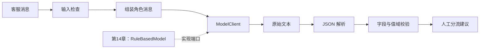

# 第 2 课：LLM 的技术栈与场景选择

> 本课约 25 分钟。目标是根据任务选择最小可用方案，并为退款分流器写出明确的数据合同。先读[第 1 课](01-what-is-llm.md)。

## 1. 先决定要解决哪类问题

“做一个 AI 功能”还不足以选技术。先把用户请求转成可观察的输入与输出：

| 业务任务 | 输入与输出 | 起步方案 | 何时升级 |
|---|---|---|---|
| 金额超过 1000 元进入人工审批 | 已有结构化金额 → 布尔值 | 普通条件判断 | 不需要 LLM |
| 将多样化客服原文分到退款/其他队列 | 自然语言 → 意图标签 | 规则基线；覆盖不足时评估 LLM | 固定样本显示 LLM 更好且成本可接受 |
| 回答“公司最新退款政策是什么” | 问题 + 被授权文档 → 带来源的答案 | 检索资料再生成，即 RAG | 资料频繁变动、需引用和权限过滤时 |
| 查询订单、计算可退金额并准备申请 | 用户目标 → 多步查询与草稿 | 固定流程先行；确需动态选择时用 Agent | 每一步有工具白名单、权限与预算 |

这张表的关键不是引入更多框架，而是确认**谁有事实来源、谁能执行动作**。模型可以建议分类或下一步，但退款金额来自订单与支付系统，退款执行来自受控接口。分类成功也不等于获得了退款权限。

## 2. “LLM 技术栈”有两张不同的地图

如果要训练或自行部署基础模型，会研究 tokenizer、Transformer、训练数据、PyTorch、分布式训练、推理框架和 GPU。这是模型工程路线，本教程不会从零训练模型。

本教程走的是**应用开发路线**。把每一层看成一个可替换的后端职责，而非必须安装的产品：

| 应用层 | 解决什么问题 | 退款分流器如何使用 |
|---|---|---|
| 模型服务与 SDK | 发送消息，拿到生成结果，处理鉴权和用量 | 第 14 章用离线替身，第 19 章接真实 SDK |
| 提示词与上下文 | 描述任务，放入客户文本和必要规则 | 用 `Message` 区分系统约束与用户原文 |
| 解析与字段合同 | 把文本转换成应用能处理的对象 | `json.loads` 后检查对象、字段和值域 |
| 业务决策 | 决定分类结果能做什么、不能做什么 | 只给客服分流建议，不执行退款 |
| 评测与可观测性 | 对照样本，记录延迟、错误、成本 | 至少记录正例、反例、拒绝情况 |
| 检索和工具 | 获取外部证据与受控动作 | 本章不需要；第 16、17、18 章再加 |

Java 开发者可把“模型服务与 SDK”看作外部客户端适配器，把“解析与字段合同”看作反序列化和 Bean Validation 边界，把“业务决策”看作领域服务。Python 的 `Protocol` 用来表达调用方需要的方法，不会自动替你做运行时校验。

## 3. 为本章案例写合同

我们先限定需求：**输入一条客服消息，输出一个供人工分流参考的意图；不自动退款，不查询真实订单。** 这样的范围足够小，能把语言理解和工程边界讲清楚。

| 项目 | 本章约定 | 为什么要写清楚 |
|---|---|---|
| 输入 | 一条非空客户文本 | 空输入没有可分类的语义 |
| 意图 | `refund` 或 `other` | 下游只能消费已知枚举 |
| 无法判断 | 拒绝或转人工，不能悄悄填 `other` | 漏判退款请求会影响客户体验 |
| 输出格式 | JSON 对象，至少有 `intent` | 便于机器解析，仍需验证 |
| `confidence` | 本章仅用固定样例值说明字段 | 未校准的模型自报数字不是可信概率 |
| 副作用 | 无 | 分流建议不能直接调用付款接口 |

**注意当前代码的教学进度：** [第 3 课](03-build-classifier.md)的离线示例只验证 JSON 根节点；[第 4 课](04-validate-and-evaluate.md)的练习再补必填字段。意图枚举、置信度范围和拒绝策略属于下一步设计，不要误以为当前示例已满足上表全部合同。

## 4. 画出数据流

第 14 章当前运行路径只做了 C、D、E、F 的一部分；B 和 G 需在应用真正上线前补齐。画架构时明确“实现了什么”与“合同要求什么”，能防止一张漂亮流程图掩盖代码缺口。

如果下一步要回答政策问题，在 C 前面加入“有权限的文档检索”，把证据和来源 ID 放进上下文；如果要操作订单，则加入受控工具和审批。RAG 是检索增强，不是给模型自动开数据库权限。Agent 是让模型参与动态选择步骤，不是所有 LLM 调用的统称。

## 5. 场景判断练习

为下面三项需求写下你选的起步方案和理由：

1. `country == "DE" and amount > 1000` 时转人工。
2. 从客户自然语言里提取“想取消订单还是想退钱”。
3. 回答“2026 年最新的德国退款期限”，要求引用公司授权文档。

可核对的答案：1 用代码规则；2 先做规则基线，覆盖不足再试 LLM 分类并评测；3 需要有权限的最新资料检索、引用和无证据时拒答，不能只靠模型记忆。把理由写进[学案](../STUDY_GUIDE.md)。

**本课产物：** 一份输入输出合同和一张标出未实现环节的数据流图。下一课运行代码，看看基线究竟能做到哪一步。
